

  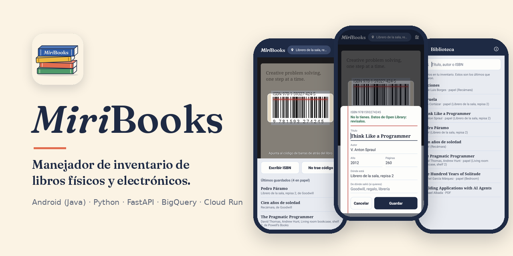

  <a href="README.md">English</a> · <b>Español</b>

<h1 align="center"><i>Miri</i>Books</h1>

<b>Apunta el celular a un libro y sabes si ya lo tienes.</b>

---

## La historia

Me encantan los libros y los compro en todos lados, sobre todo cuando viajo. Con los años, mi biblioteca
quedó repartida en varias casas y en una carpeta llena de PDF y EPUB. Un día me di cuenta de que ya no sabía
qué tenía, y había empezado a comprar dos veces el mismo libro.

Así que hice **MiriBooks**: una app que junta **todos mis libros, en papel y digitales, en un solo
inventario**, pensada para consultarla desde el pasillo de una librería antes de comprar. Registrar un libro en papel es
rápido: elijo el librero, escaneo, guardo y sigo con el siguiente.

  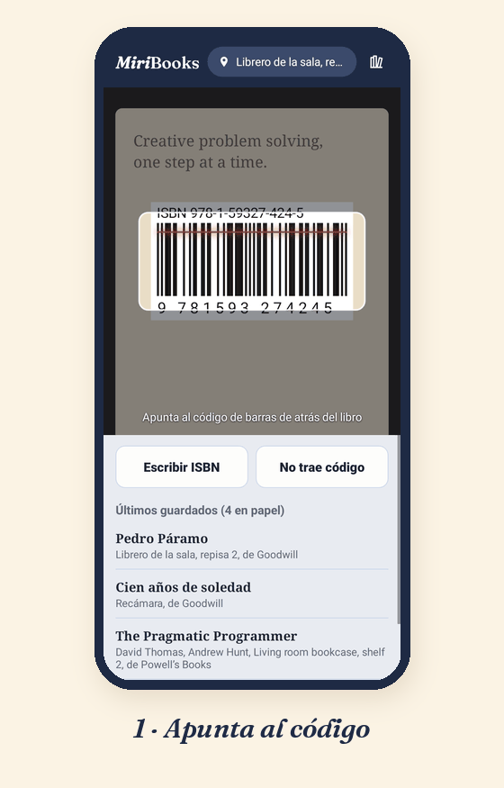

## Qué hace

### Escaneas y sabes al instante

Apuntas la cámara al código de barras de atrás del libro. MiriBooks lo reconoce y contesta:

- **«No lo tienes»**: los datos del libro (título, autor, año, páginas) vienen llenos desde catálogos públicos
  cuando lo tienen. Los revisas y guardas.
- **«Ya lo tienes: PDF, papel (Sala)»**: te dice en qué formatos y dónde.
- **«Tienes otra edición»**: el mismo libro con otro ISBN, para que tú decidas.

  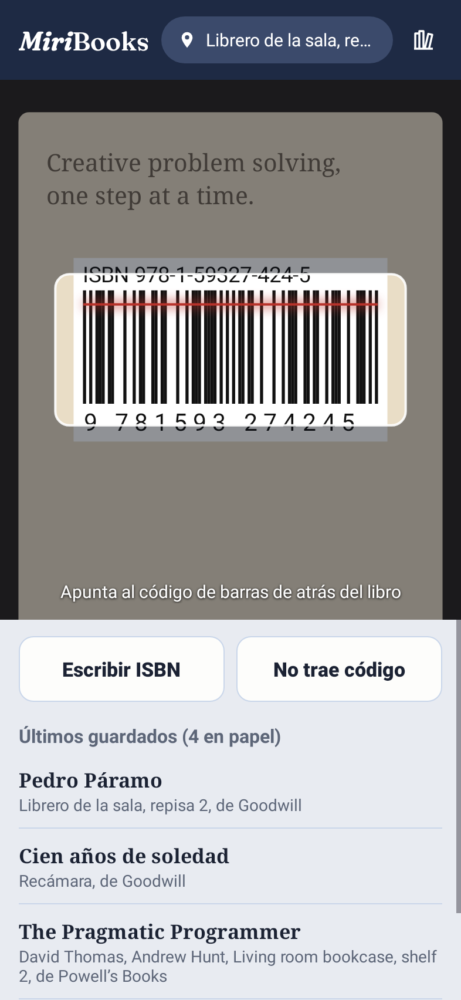
  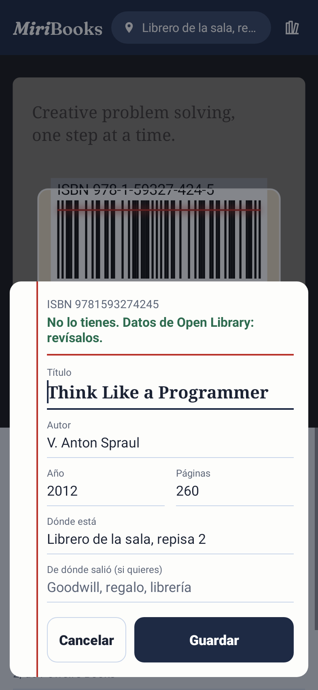
  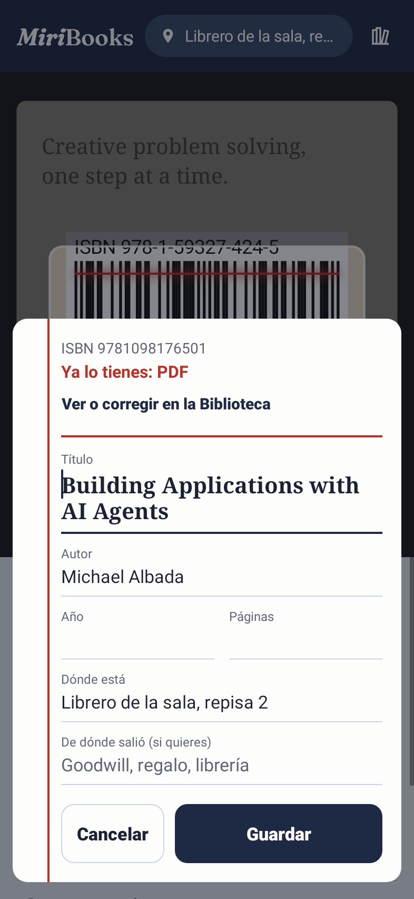

### Hecha para registrar libro tras libro

- **Eliges el lugar una vez** («Librero de la sala, repisa 2») y todos los libros se guardan ahí.
- **Escaneo seguido:** guardas y la cámara ya espera el siguiente libro.
- **No se confunde con el código del precio** ni vuelve a abrir por accidente el libro que acabas de guardar.
- **¿Sin código de barras?** Escribes el ISBN o, para libros viejos, título y autor.

  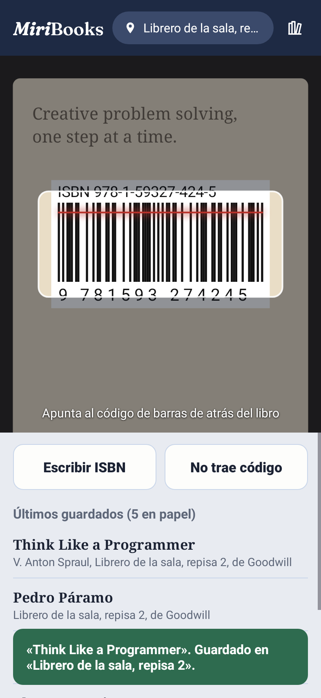
  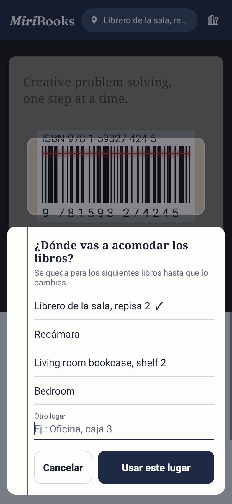
  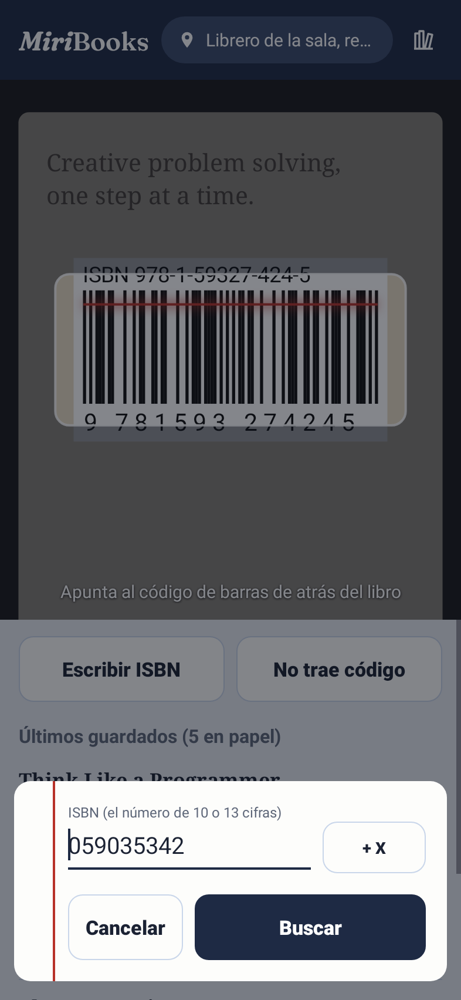

### No le cree todo a internet

Los catálogos públicos se equivocan: a veces un ISBN apunta al libro equivocado. MiriBooks se da cuenta
cuando el título que corregiste ya no se parece al del catálogo, te avisa en lenguaje claro y se queda con
tus datos. Ninguna carga automática pisa lo que corriges a mano.

  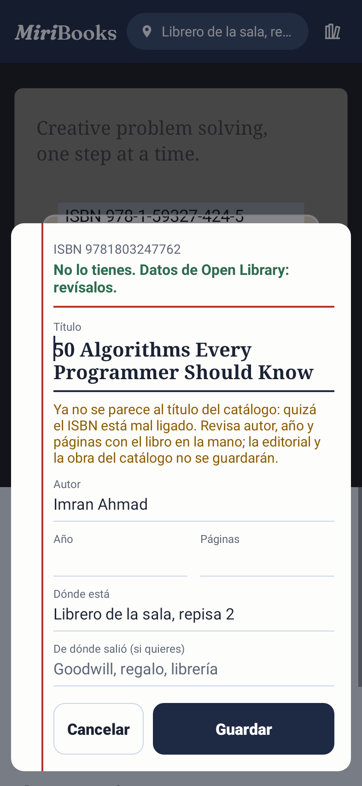

### Toda tu biblioteca en el bolsillo

La **Biblioteca** tiene todo: libros en papel, PDF y EPUB. Buscas por título, autor o ISBN (los acentos no
importan: «garcia marquez» encuentra a García Márquez), corriges los datos de un libro, cambias una copia de
librero o la eliminas. La carpeta de libros electrónicos se carga completa de una vez, así que los digitales también están.

  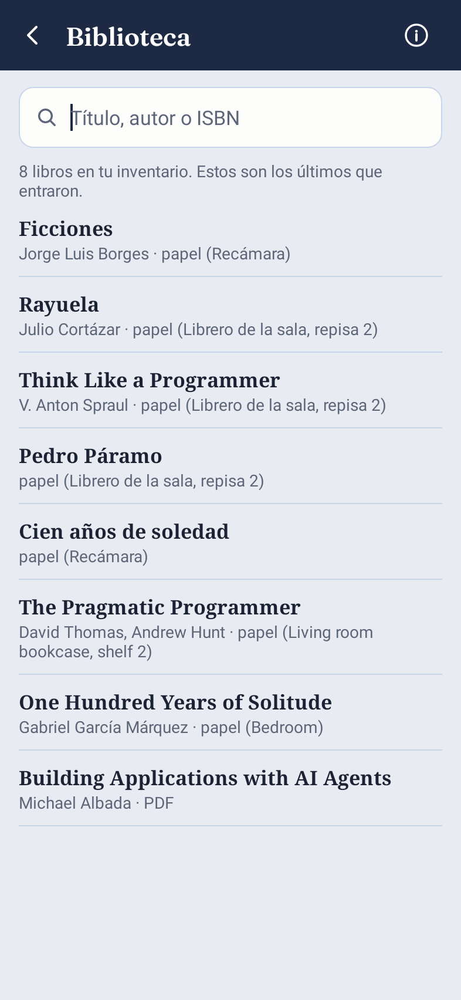
  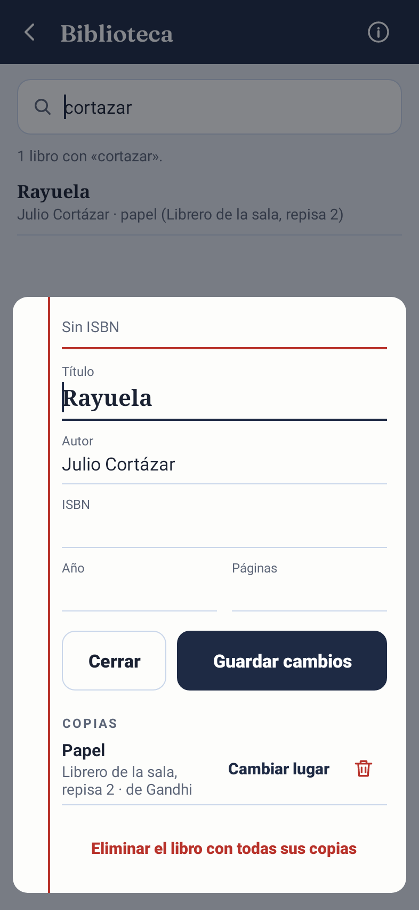
  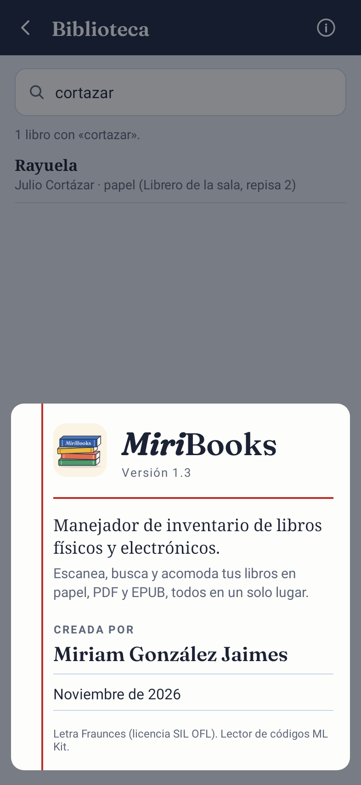

### Se abre con tu huella

Sin contraseñas que recordar. Solo tu huella abre tu inventario, y registrar un celular nuevo es escanear
un código QR.

### Español e inglés, claro y oscuro

Toda la app sigue el idioma y el tema de tu celular.

  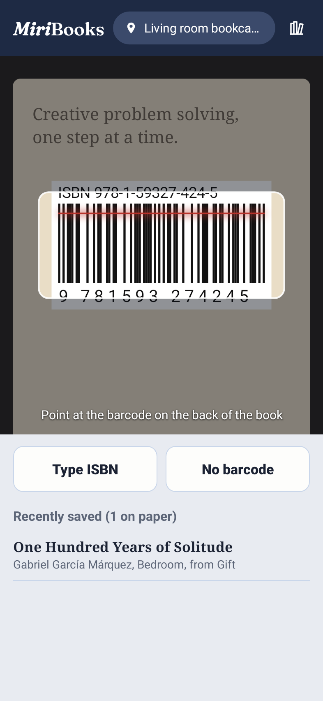
  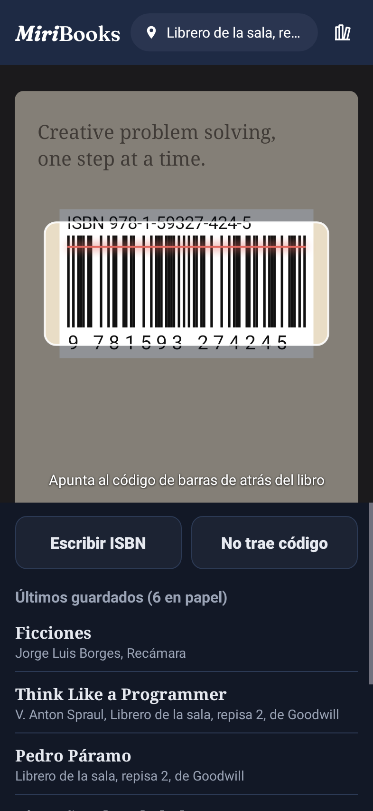
  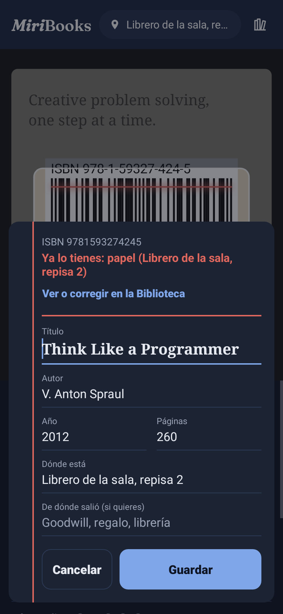

## Lo que hice

Llevé MiriBooks de la idea a una app que ya uso en mi celular:

- **Producto:** definí el problema, y el uso principal: consultar antes de comprar.
- **Datos:** diseñé el modelo del inventario y las reglas que cuidan la integridad y la consistencia de
  cada dato (más abajo).
- **Experiencia y diseño:** el flujo del escáner, los avisos y una identidad visual propia: el ícono, la
  tipografía y la paleta «Jardín».
- **Desarrollo:** la app nativa de Android, el servicio en la nube y la base de datos de libros, además del
  cargador de libros electrónicos.
- **Calidad:** cientos de pruebas automáticas, incluidas las que recorren las pantallas de la app en
  los dos idiomas.
  Las capturas de esta página las generan esas pruebas.

**Hecha con:** Java (Android) · Python · Google Cloud (Cloud Run, BigQuery) · lectura de códigos con ML Kit ·
seguridad con huella (Keystore de Android).

Construida sobre Google Cloud, la plataforma que ya uso en otros proyectos, sin herramientas
adicionales: el servicio se apaga solo cuando nadie lo usa y se paga únicamente por uso. El inventario vive en
BigQuery porque su destino es el análisis.

## Primero los datos

**Ningún sistema, modelo ni estrategia funciona bien si sus datos no son confiables.** Por eso, la primera meta fue tener **una sola fuente de datos confiable** para mi biblioteca, cuidando la **integridad y la
consistencia** del dato en cada paso:

- **Un solo inventario, en un solo lugar.** Libros en papel, PDF y EPUB viven en una sola base de datos en
  la nube, modelada como el inventario de un negocio: cada *libro* aparece una vez, y cada *copia*, física o
  digital, guarda su formato y dónde está.
- **Se valida desde la entrada.** Un código de barras solo se acepta si es un ISBN real con su dígito
  verificador correcto; los códigos de precio o de tienda se rechazan.
- **Reglas claras de qué fuente manda.** Primero el libro mismo, luego los catálogos públicos, luego el
  nombre del archivo; lo adivinado queda marcado para revisar.
- **Los catálogos se revisan, no se creen a ciegas.** Cuando el título de un catálogo no se parece al del libro,
  MiriBooks avisa y se queda con el dato del libro.
- **Sin duplicados ni confusiones.** Las ediciones distintas se mantienen separadas; si el mismo libro llega dos veces,
  se junta en uno solo.
- **Lo que corrijo a mano es definitivo.** Ninguna carga automática posterior lo vuelve a pisar.
- **Actualizaciones seguras.** Una carga masiva no borra lo que guardé desde el celular mientras corría, y
  puedo sacar respaldos con fecha cuando quiera.
- **Comprobado con pruebas.** Cada una de estas reglas está cubierta por pruebas automáticas.

## Sobre este repositorio

Esta es la **vitrina** de MiriBooks. El código completo es privado; la carpeta
[`fragmentos/`](fragmentos/) tiene algunas piezas escogidas para mostrar cómo está escrito.

- [Guía de uso](docs/guia-de-uso.md) · [User guide](docs/user-guide.md)
- El proyecto también tiene un **manual técnico** detallado (arquitectura, modelo de datos, seguridad,
  despliegue y pruebas), que se queda privado junto con el código. Con gusto lo explico en una conversación.

## Autora

**Miriam González Jaimes**: idea, diseño, desarrollo y pruebas. Noviembre de 2026.

Vengo del mundo de riesgos, donde trabajé en los dos lados: los modelos y las estrategias, y los datos que
los hacen confiables (asegurar la fuente, transformar, validar y confirmar). Esa forma de trabajar es la
que llevé a MiriBooks.

© 2026 Miriam González Jaimes. Todos los derechos reservados: ver [LICENSE](LICENSE). Letra Fraunces de
Undercase Type (SIL Open Font License). Lectura de códigos con Google ML Kit. Datos de los libros de Open
Library y Google Books.
