

  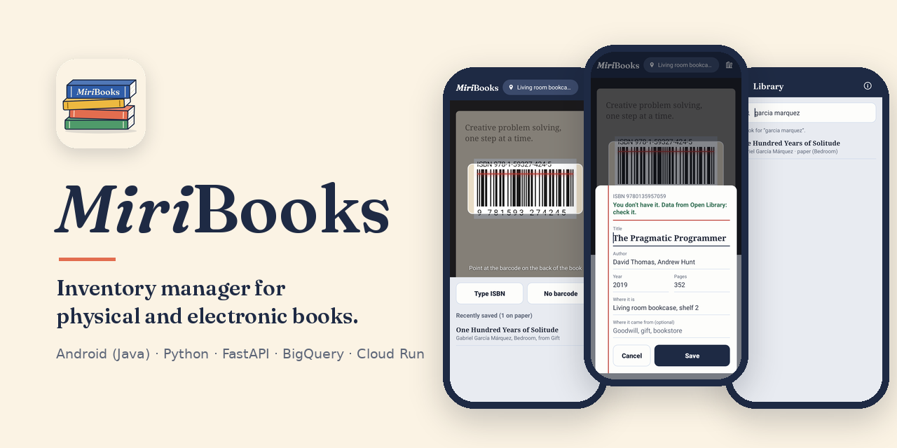

  <b>English</b> · <a href="README.es.md">Español</a>

<h1 align="center"><i>Miri</i>Books</h1>

<b>Point your phone at a book and know if you already own it.</b>

---

## The story

I love books, and I buy them everywhere, especially when I travel. Over the years my library spread across
several houses and a folder full of PDFs and EPUBs. One day I realized I no longer knew what I owned, and I
had started buying the same book twice.

So I built **MiriBooks**: an app that keeps **all my books, on paper and digital, in one inventory**, designed to be checked from a bookstore aisle before buying. Registering a paper book is fast: I choose the
bookcase, scan, save, and move on to the next one.

  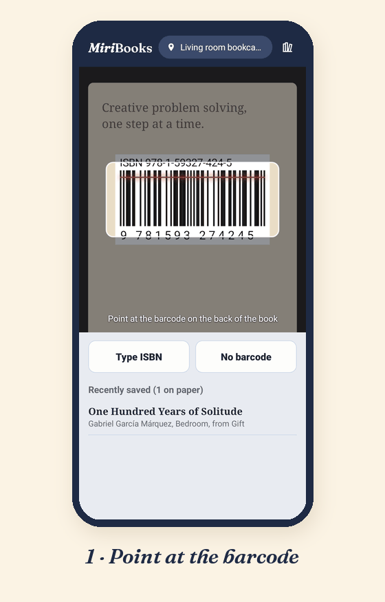

## What it does

### Scan and know, instantly

Point the camera at the barcode on the back of the book. MiriBooks recognizes it and answers:

- **“You don't have it”**: the book's details (title, author, year, pages) are filled in from public book catalogs
  when they have it. Check them and save.
- **“You already have it: PDF, paper (Living room)”**: it tells you in which formats and where.
- **“You have another edition”**: the same book with a different ISBN, so you can decide.

  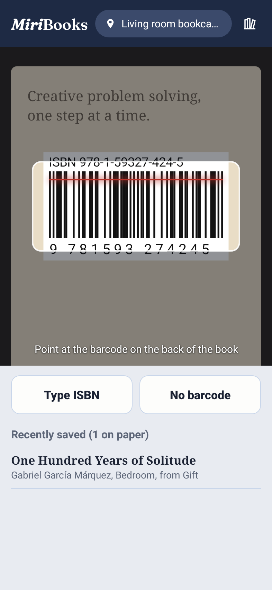
  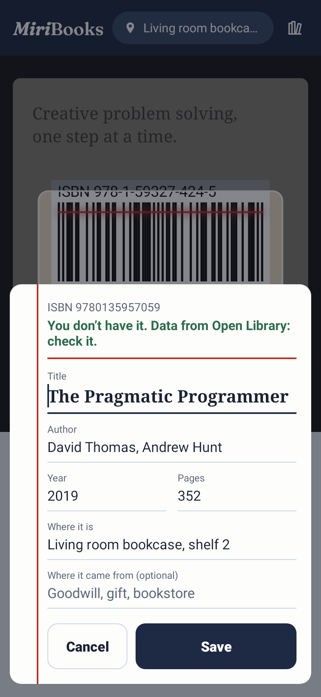
  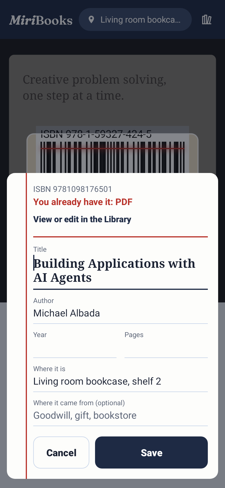

### Built for registering book after book

- **Choose the place once** (“Living room bookcase, shelf 2”) and every book goes there.
- **Continuous scanning:** save, and the camera is already waiting for the next book.
- It **ignores the price sticker** barcode and won't reopen the book you just saved by accident.
- **No barcode?** Type the ISBN, or enter title and author for old books.

  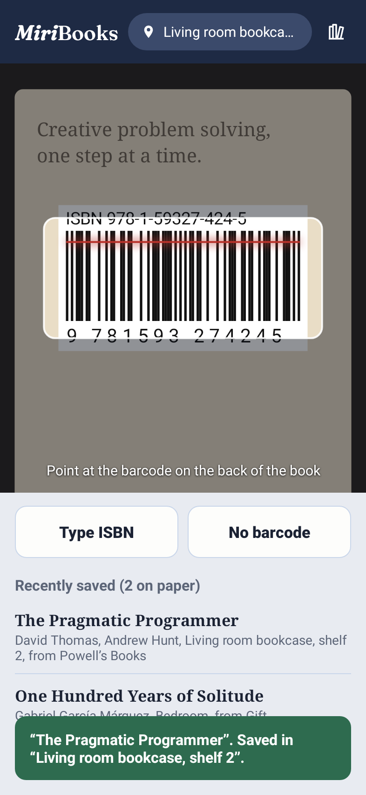
  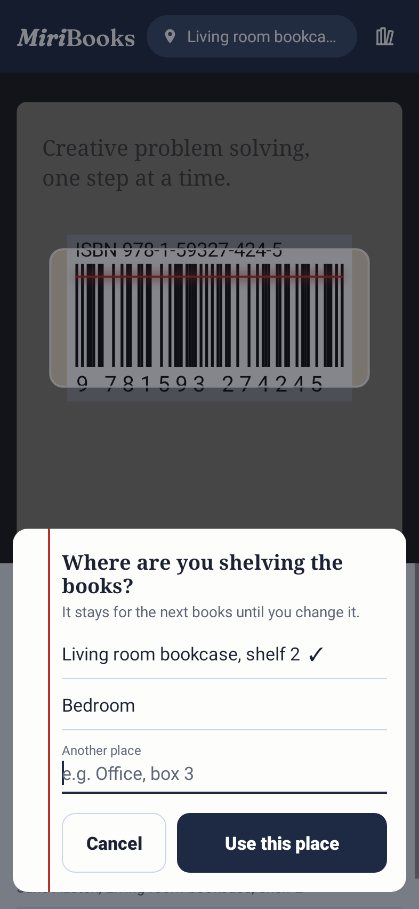
  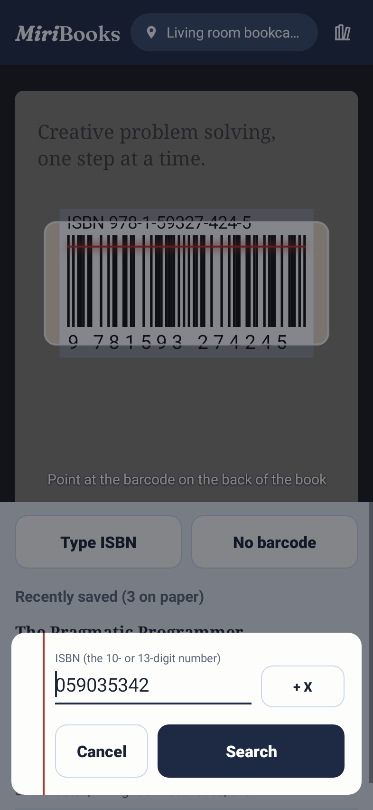

### It doesn't blindly trust the internet

Public catalogs make mistakes: sometimes an ISBN points to the wrong book. MiriBooks notices when the title
you corrected no longer matches the catalog's, warns you in plain language, and keeps your data instead.
No automatic import overwrites what you correct by hand.

  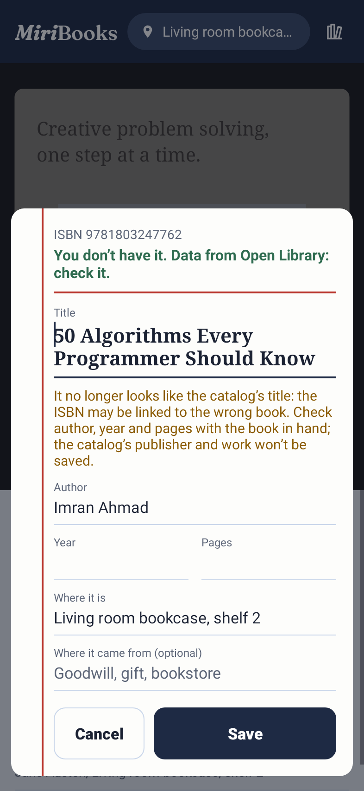

### Your whole library, in your pocket

The **Library** holds everything: paper books, PDFs and EPUBs. Search by title, author or ISBN (accents
don't matter: “garcia marquez” finds García Márquez), fix a book's details, move a copy to another shelf,
or remove it. Your whole e-book folder is imported in one step, so digital books are there too.

  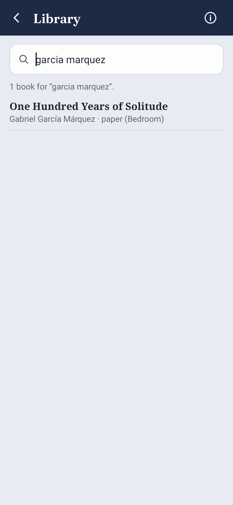
  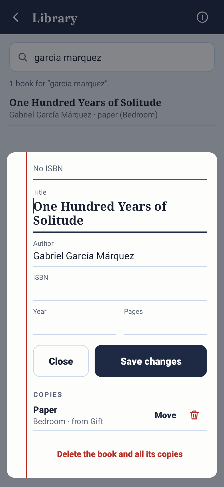
  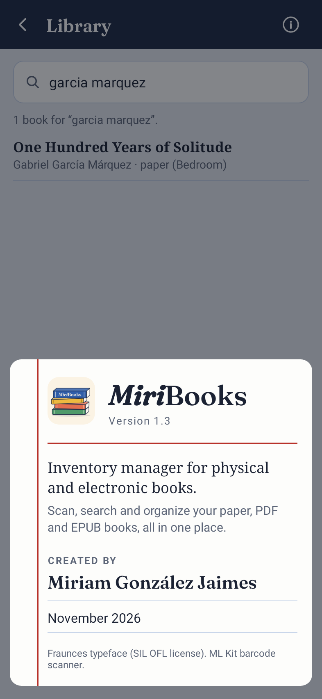

### Opens with your fingerprint

No passwords to remember. Only your fingerprint unlocks your inventory, and setting up a new phone is a
single scan of a QR code.

### English and Spanish, light and dark

The whole app follows your phone's language and theme.

  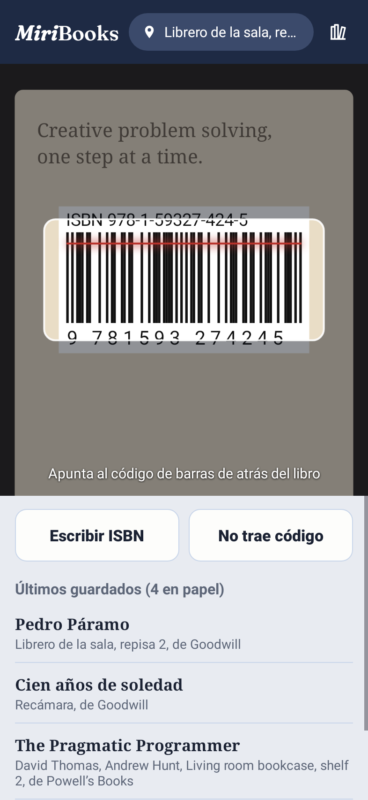
  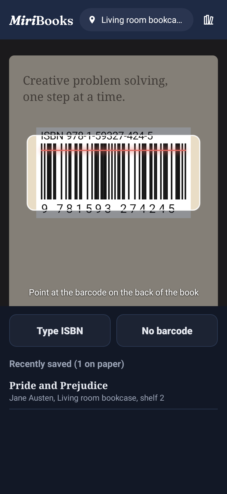
  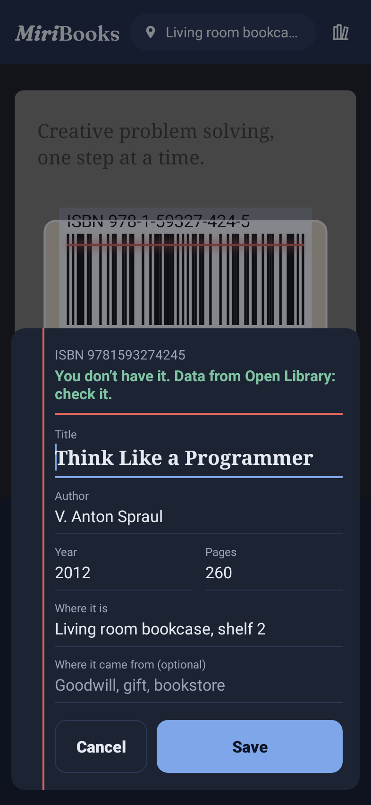

## What I did

I took MiriBooks from idea to an app I already use on my phone:

- **Product:** defined the problem, and the main use case: check before buying.
- **Data:** designed the inventory model and the rules that guard the integrity and consistency of every
  record (see below).
- **Experience and design:** the scanning flow, the warnings, and a visual identity of its own: the icon,
  typography and “Garden” color palette.
- **Development:** a native Android app, a cloud service and the book database, plus the importer for
  e-books.
- **Quality:** hundreds of automated tests, including tests that walk through the app's screens in
  both languages. The screenshots on this page are generated by those tests.

**Built with:** Java (Android) · Python · Google Cloud (Cloud Run, BigQuery) · ML Kit barcode scanning ·
fingerprint security (Android Keystore).

Built on Google Cloud, the platform I already use for other projects, with no extra tools:
the service shuts down on its own when nobody is using it, and it's billed only for actual use. The inventory
lives in BigQuery because it's meant for analysis.

## Data first

**No system, model or strategy works well on data it can't trust.** That's why the
first goal was a **single, trustworthy source of truth** for my library, with **integrity and consistency** guarded at every
step:

- **One inventory, one place.** Paper books, PDFs and EPUBs live in a single cloud database, modeled like a
  retail inventory: each *book* appears once, and each physical or digital *copy* records its format and
  where it is.
- **Validated at the door.** A barcode is accepted only if it is a real ISBN with a correct check digit;
  price and store barcodes are rejected.
- **Clear rules about which source wins.** The book itself first, then public catalogs, then the file name;
  anything guessed is flagged for review.
- **Catalogs are checked, not trusted.** When a catalog's title doesn't match the book's, MiriBooks warns
  you and keeps the book's data.
- **No duplicates, no confusion.** Different editions stay separate; if the same book arrives twice, it is
  merged into one.
- **Human corrections are final.** Anything I fix by hand is never overwritten by later automatic imports.
- **Safe updates.** A bulk import doesn't overwrite books saved from the phone while it was running, and
  dated backups can be taken at any time.
- **Proven by tests.** Every one of these rules is covered by automated tests.

## About this repository

This is the **showcase** of MiriBooks. The full source code is private; the
[`fragmentos/`](fragmentos/) folder holds a few selected pieces to show how it's written.

- [User guide](docs/user-guide.md) · [Guía de uso](docs/guia-de-uso.md)
- The project also has a detailed **technical manual** (architecture, data model, security,
  deployment and testing), kept private with the code. Happy to walk through it in a conversation.

## Author

**Miriam González Jaimes**: idea, design, development and testing. November 2026.

I come from risk management, where I worked on both sides: the models and strategies, and the data that
makes them reliable (securing the source, transforming, validating and reconciling it). That's the way of
working I brought to MiriBooks.

© 2026 Miriam González Jaimes. All rights reserved: see [LICENSE](LICENSE). Fraunces typeface by Undercase
Type (SIL Open Font License). Barcode reading by Google ML Kit. Book data from Open Library and Google Books.
