# MiriBooks · Guía de uso

Todo lo que necesitas para registrar tus libros con el celular y mantener tu inventario en orden.

← [Volver al README](../README.es.md) · [English](user-guide.md)

> Las capturas salen de las pruebas automáticas de la app. Como una computadora no tiene cámara, el visor
> muestra la ilustración de un código de barras; en tu celular verás la cámara de verdad.

---

## Contenido

1. [Instalar la app](#1-instalar-la-app)
2. [Registrar tu celular (una sola vez)](#2-registrar-tu-celular-una-sola-vez)
3. [Entrar con tu huella](#3-entrar-con-tu-huella)
4. [Elegir el lugar](#4-elegir-el-lugar)
5. [Escanear un libro](#5-escanear-un-libro)
6. [Lo que te puede decir la ficha](#6-lo-que-te-puede-decir-la-ficha)
7. [Libros sin código de barras](#7-libros-sin-código-de-barras)
8. [Biblioteca: buscar, corregir y eliminar](#8-biblioteca-buscar-corregir-y-eliminar)
9. [Acerca de, idioma y modo oscuro](#9-acerca-de-idioma-y-modo-oscuro)
10. [Consejos para registrar muchos libros](#10-consejos-para-registrar-muchos-libros)
11. [Preguntas frecuentes](#11-preguntas-frecuentes)

---

## 1. Instalar la app

1. Copia `MiriBooks.apk` al celular (por ejemplo, a la carpeta **Download** o a una carpeta **Apps**).
2. Ábrelo desde **Archivos** y toca **Instalar**. Si el celular pregunta, permite instalar apps de esa
   fuente.
3. Si aparece Play Protect, toca **Más detalles → Instalar de todas formas**: aparece con cualquier app que
   no viene de Google Play.

**Para actualizar** a una versión nueva, abre el nuevo `MiriBooks.apk` y toca **Actualizar**. No pierdes
nada: tu registro y tus libros se quedan.

Necesitas Android 9 o más nuevo y una huella registrada en el celular.

## 2. Registrar tu celular (una sola vez)

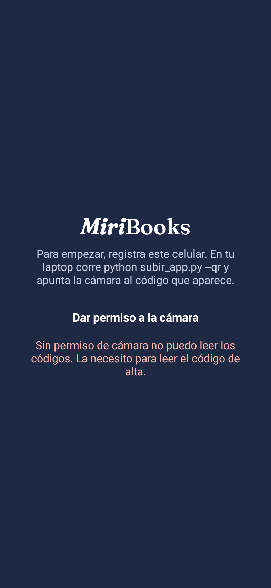

1. En la computadora se genera el código QR de alta (lo da el programa que instala el servidor).
2. Abre MiriBooks: la primera vez te pide escanear ese código.
3. Apunta la cámara al código y pon tu huella.

Listo: el celular quedó registrado. El código QR solo sirve para dar de alta celulares tuyos; no lo
compartas.

**Si cambias tus huellas** (agregas o quitas un dedo en Ajustes), Android invalida la llave por seguridad y
la app te pedirá escanear el código otra vez.

 

## 3. Entrar con tu huella

Cada vez que abres la app te pide la huella. La sesión dura **12 horas**; después la vuelve a pedir. Nadie
que tome tu celular puede ver ni cambiar tu inventario sin tu huella.

## 4. Elegir el lugar

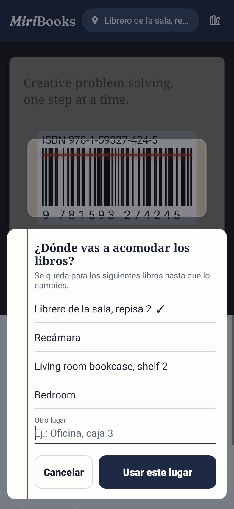

Arriba, junto al nombre de la app, está el **lugar**: el librero, cuarto o casa donde estás registrando. Se
queda fijo, así que lo eliges una vez y todos los libros que escanees se guardan ahí.

- Toca el lugar para cambiarlo.
- La app te sugiere los lugares que ya usaste, para que no escribas «Sala» de tres formas distintas.
- Puedes escribir uno nuevo: «Casa del pueblo · librero azul».

 

## 5. Escanear un libro

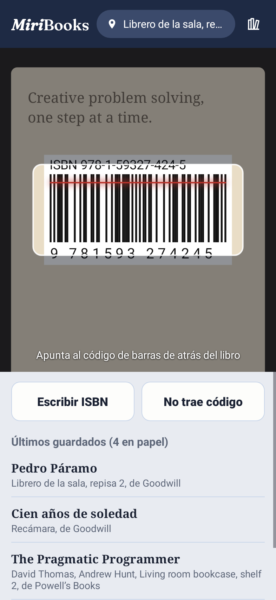

1. Apunta la cámara al código de barras de atrás del libro. Es el que empieza con **978** o **979**.
2. En un segundo se abre la **ficha** con los datos que encontró.
3. Revísalos, corrige lo que haga falta y toca **Guardar**.
4. La cámara queda lista para el siguiente libro.

Abajo de la cámara ves los últimos libros que guardaste y cuántos libros en papel llevas.

**De dónde salió (si quieres)** (Goodwill, regalo, librería de viaje…) es opcional y empieza vacío en cada libro.

 

## 6. Lo que te puede decir la ficha

  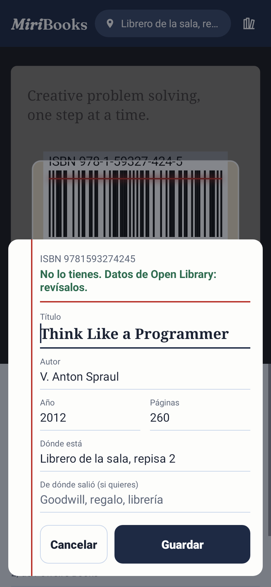
  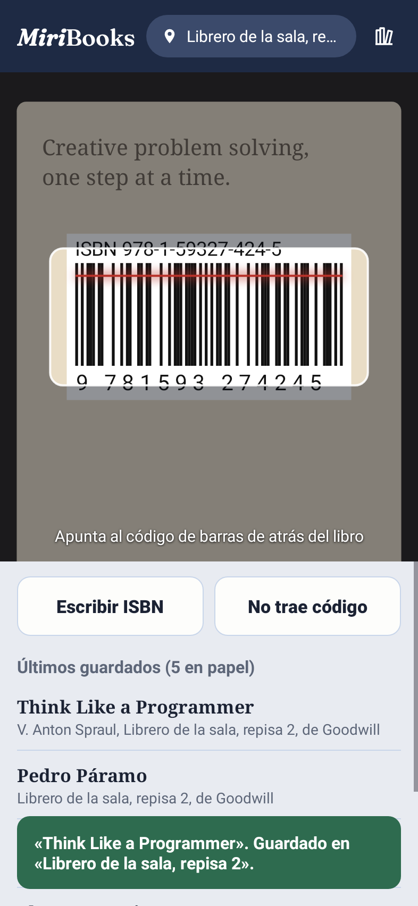
  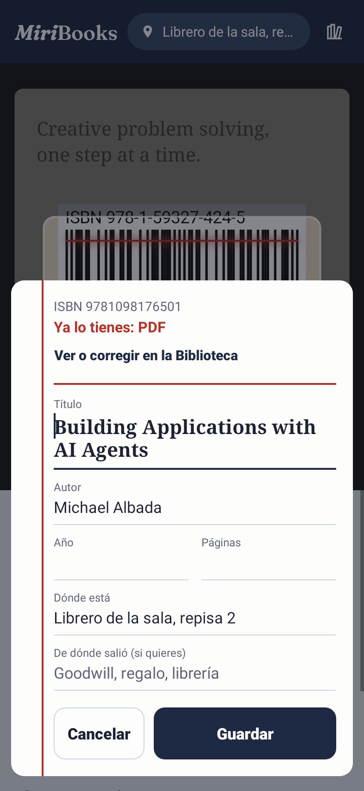
  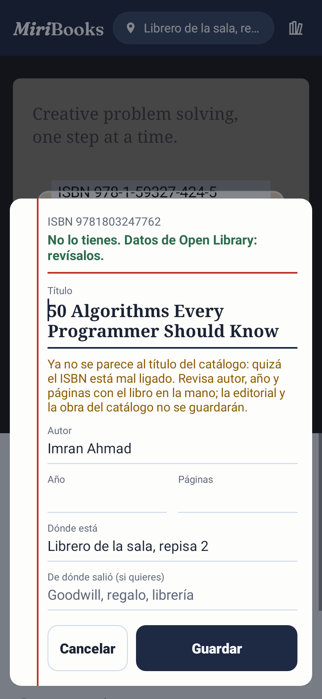

| Aviso | Qué significa | Qué hacer |
|---|---|---|
| **No lo tienes. Datos de Open Library: revísalos.** | Es nuevo; los datos vienen de un catálogo. | Revísalos y guarda. |
| **Ya lo tienes:** PDF, papel (Sala) | Ya está en tu inventario y te dice en qué formatos y dónde. | Si es otra copia en papel, puedes guardarla igual; si no, cierra. **Ver o corregir en la Biblioteca** abre su ficha completa. |
| **Tienes otra edición** | Tienes el mismo libro con otro ISBN (por ejemplo, el PDF). | Decide si quieres esta edición también. |
| **No lo encontré en internet** | Ningún catálogo lo conoce. | Escribe título y autor. |
| **Ya no se parece al título del catálogo** | Corregiste el título y ya no se parece al del ISBN. | Ese ISBN suele estar mal ligado en el catálogo; la app guarda tus datos y no usa los del catálogo. |
| **Ese código no es el del libro** | Leíste el código de precio o de la tienda. | Busca el que empieza con 978 o 979. |

## 7. Libros sin código de barras

  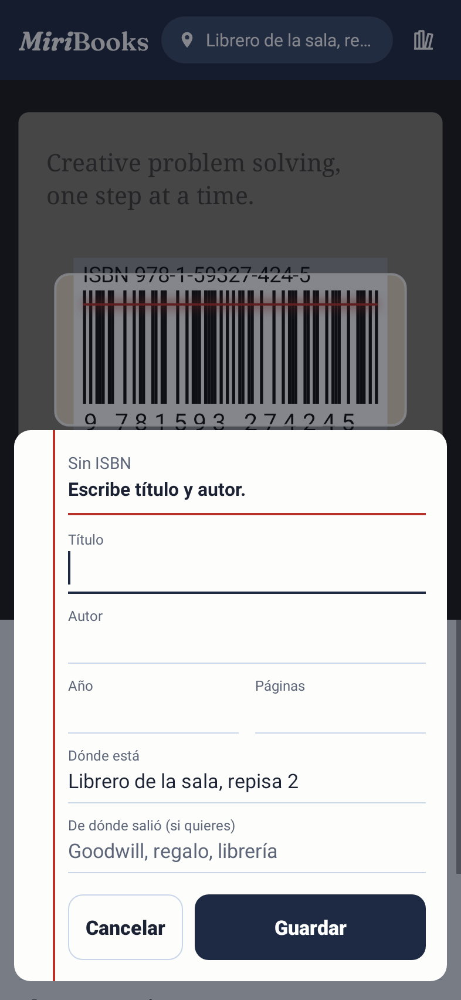
  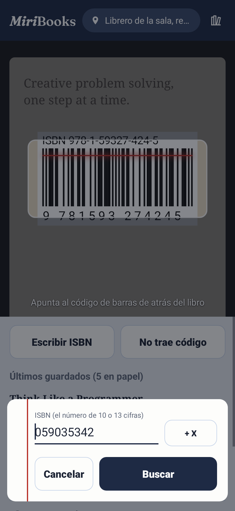

- **Escribir el ISBN:** si el código está tapado o roto, toca **Escribir ISBN** y escríbelo (con o sin guiones;
  sirven el de 10 y el de 13 dígitos). Muchos libros lo traen en la página de derechos.
- **No trae código:** para libros viejos o artesanales, toca **No trae código** y llena título y autor a mano.

## 8. Biblioteca: buscar, corregir y eliminar

  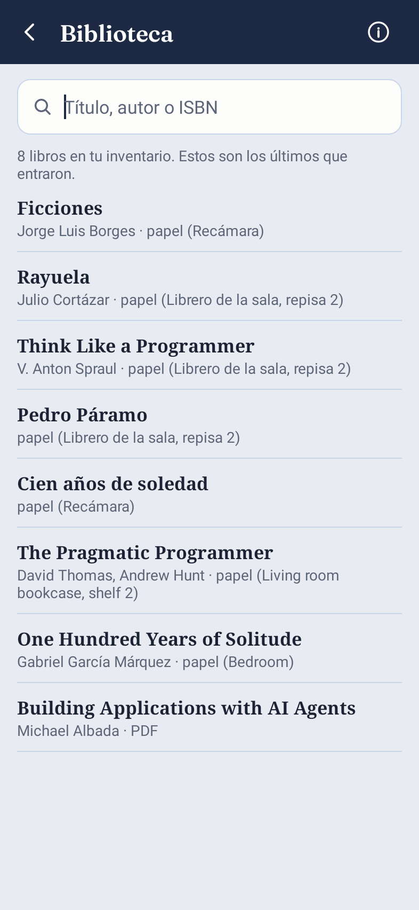
  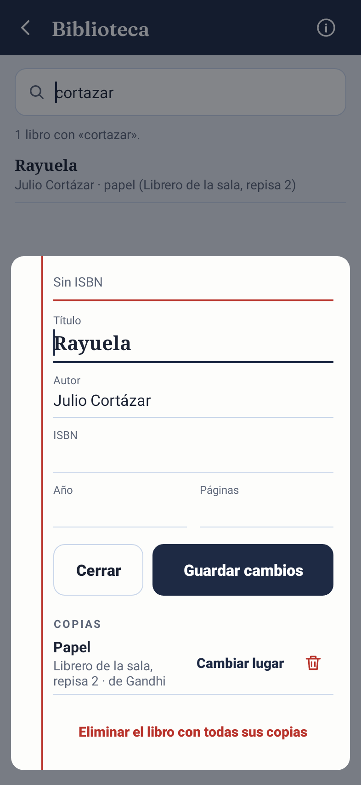
  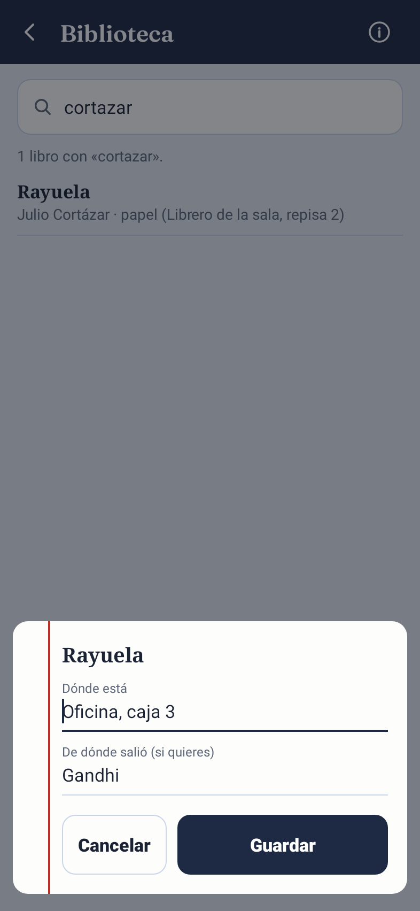
  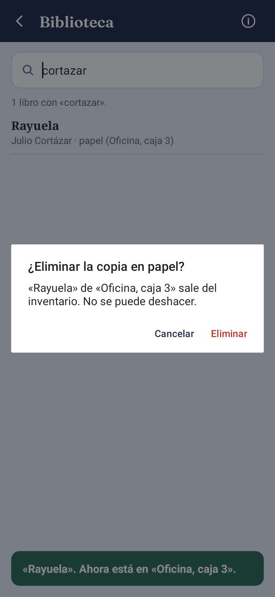

Toca **Biblioteca** (arriba a la derecha). Ahí está **todo** tu inventario: libros en papel, PDF y EPUB.

- **Buscar:** escribe parte del título, del autor o el ISBN. No importan los acentos: «cortazar» encuentra a
  Cortázar. Sin texto, ves los últimos que agregaste.
- **Corregir:** toca un libro, cambia título, autor, ISBN, año o páginas y guarda. Lo que corriges a mano
  **nunca** lo vuelve a cambiar la carga de libros digitales.
- **Cambiar de lugar:** en la lista de copias, toca una copia en papel para moverla a otro lugar o cambiar
  su procedencia.
- **Eliminar una copia:** desde la misma hoja. Si era la única, el libro sale del inventario.
- **Eliminar el libro:** con todas sus copias. La app siempre te pide confirmar.

**Ojo con los digitales:** eliminar un PDF o EPUB lo quita del **inventario**, no de tu carpeta. Si el
archivo sigue ahí, regresa la próxima vez que se carguen los libros digitales. Para quitarlo para siempre,
bórralo también de la carpeta.

## 9. Acerca de, idioma y modo oscuro

  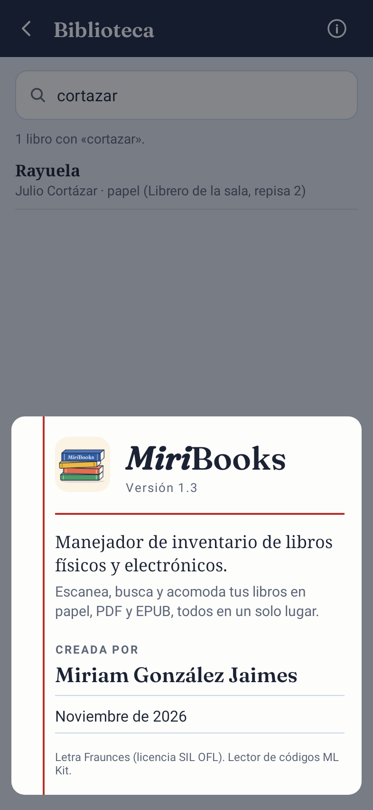
  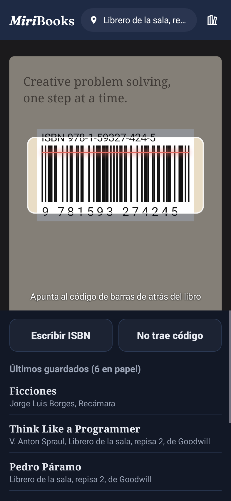
  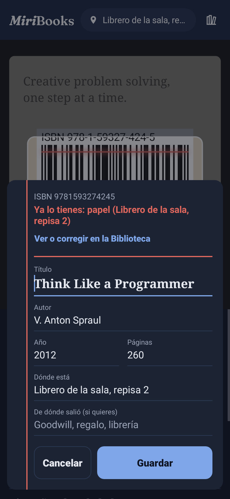

- **Acerca de:** en la Biblioteca, toca el ícono ⓘ. Ves la versión de la app.
- **Idioma:** la app habla español o inglés según el idioma de tu celular (Ajustes → Sistema → Idiomas).
  Cualquier otro idioma sale en inglés.
- **Modo oscuro:** sigue el del celular, sin hacer nada.

## 10. Consejos para registrar muchos libros

- **Un librero a la vez.** Elige el lugar, saca una fila, escanea todo y regrésala. Es más rápido que
  andar cambiando de lugar.
- **Etiquetas de segunda mano:** muchas tapan el código; despégalas antes de escanear o escribe el ISBN.
- **Revisa solo lo raro.** Si la ficha dice «No lo tienes» y el título se ve bien, guarda sin más.
- **Antes de comprar:** en la librería, escanea el libro y la ficha te dice si ya lo tienes, en papel o en
  digital.
- **Sin señal:** la app necesita internet para buscar y guardar. En un lugar sin señal, apila los libros y
  escanéalos cuando tengas conexión.

## 11. Preguntas frecuentes

**¿Dónde se guardan mis libros?** En tu inventario en la nube (BigQuery). El celular no guarda la lista:
si lo pierdes o lo cambias, instalas la app en el nuevo, lo registras con el QR y todo sigue ahí.

**La primera búsqueda tardó unos segundos.** El servidor se duerme cuando nadie lo usa para no gastar;
despierta en unos segundos. Las siguientes son inmediatas.

**¿Puedo registrar el mismo libro dos veces?** Sí, si tienes dos copias en papel (por ejemplo, una en cada
casa). Cada copia tiene su lugar.

**¿Por qué el PDF y el libro en papel salen como libros distintos?** Porque casi siempre tienen ISBN
distinto: son ediciones diferentes. La ficha te avisa con «Tienes otra edición».
