# MiriBooks · User guide

Everything you need to register your books with your phone and keep your inventory tidy.

← [Back to the README](../README.md) · [Español](guia-de-uso.md)

> The screenshots come from the app's automated tests. A computer has no camera, so the viewfinder shows an
> illustration of a barcode; on your phone you will see the real camera.

---

## Contents

1. [Install the app](#1-install-the-app)
2. [Register your phone (once)](#2-register-your-phone-once)
3. [Sign in with your fingerprint](#3-sign-in-with-your-fingerprint)
4. [Choose the place](#4-choose-the-place)
5. [Scan a book](#5-scan-a-book)
6. [What the book card can tell you](#6-what-the-book-card-can-tell-you)
7. [Books without a barcode](#7-books-without-a-barcode)
8. [Library: search, edit and delete](#8-library-search-edit-and-delete)
9. [About, language and dark mode](#9-about-language-and-dark-mode)
10. [Tips for registering lots of books](#10-tips-for-registering-lots-of-books)
11. [FAQ](#11-faq)

---

## 1. Install the app

1. Copy `MiriBooks.apk` to your phone (for example, to **Download** or to an **Apps** folder).
2. Open it from **Files** and tap **Install**. If asked, allow installing apps from that source.
3. If Play Protect shows up, tap **More details → Install anyway**: it appears for any app that does not
   come from Google Play.

**To update**, open the new `MiriBooks.apk` and tap **Update**. Nothing is lost: your registration and your
books stay.

You need Android 9 or newer and a fingerprint set up on the phone.

## 2. Register your phone (once)

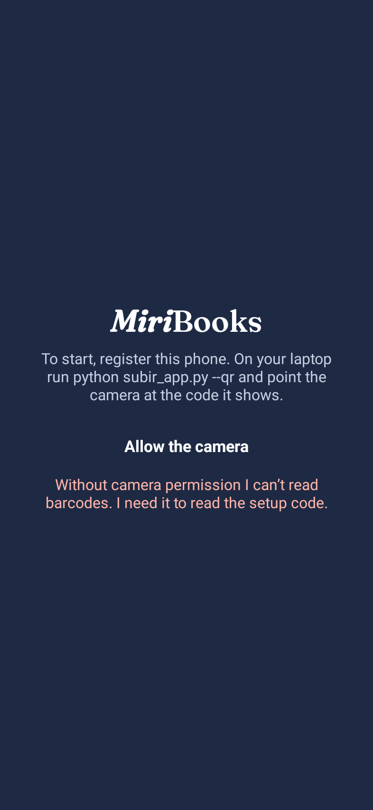

1. On the computer, generate the setup QR code (the tool that installs the server provides it).
2. Open MiriBooks: the first time, it asks you to scan that code.
3. Point the camera at the code and touch the sensor.

Done: the phone is registered. The QR code only registers your own phones; don't share it.

**If you change your fingerprints** (add or remove a finger in Settings), Android invalidates the key for
security and the app will ask you to scan the code again.

 

## 3. Sign in with your fingerprint

Every time you open the app it asks for your fingerprint. The session lasts **12 hours**, then it asks
again. Nobody who picks up your phone can see or change your inventory without your fingerprint.

## 4. Choose the place

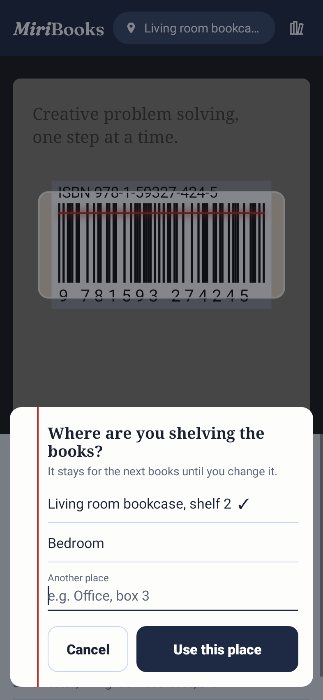

At the top, next to the app name, is the **place**: the bookcase, room or house you are registering. It
stays fixed, so you choose it once and every book you scan is saved there.

- Tap the place to change it.
- The app suggests places you already used, so you don't type “Living room” three different ways.
- You can type a new one: “Country house · blue bookcase”.

 

## 5. Scan a book

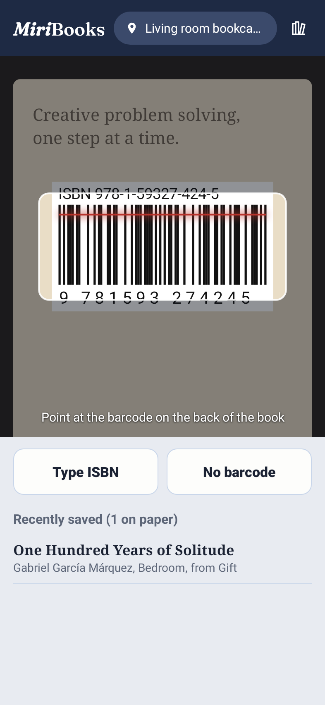

1. Point the camera at the barcode on the back of the book. It's the one that starts with **978** or **979**.
2. In a second the **book card** opens with the data it found.
3. Check it, fix anything that needs it and tap **Save**.
4. The camera is ready for the next book.

Below the camera you see the last books you saved and how many paper books you have.

**Where it came from (optional)** (thrift store, gift, bookstore abroad…) is optional and starts empty for every book.

 

## 6. What the book card can tell you

  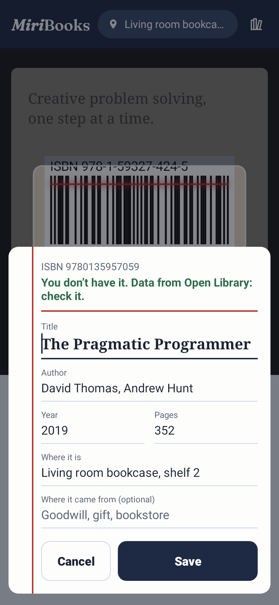
  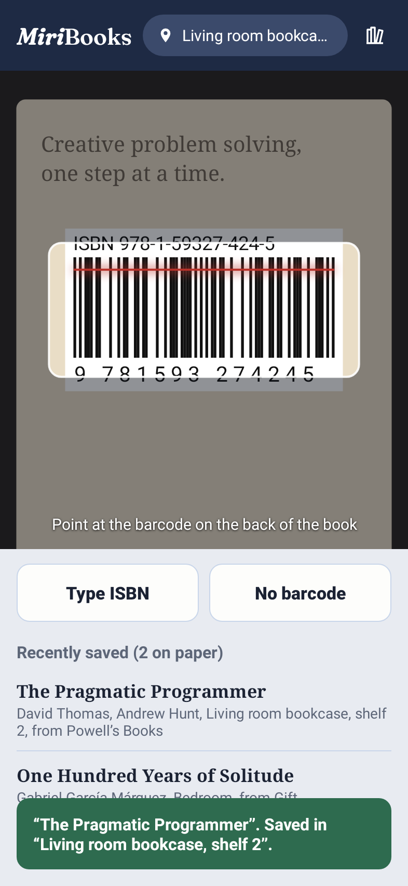
  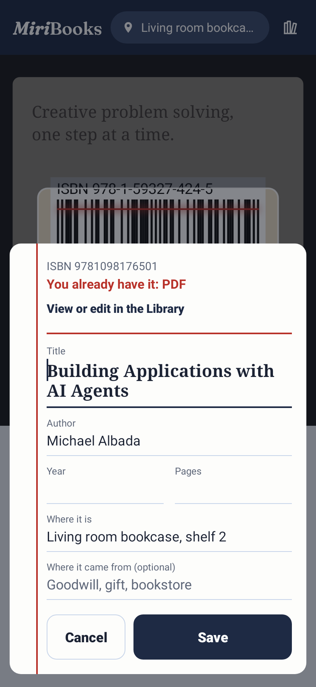
  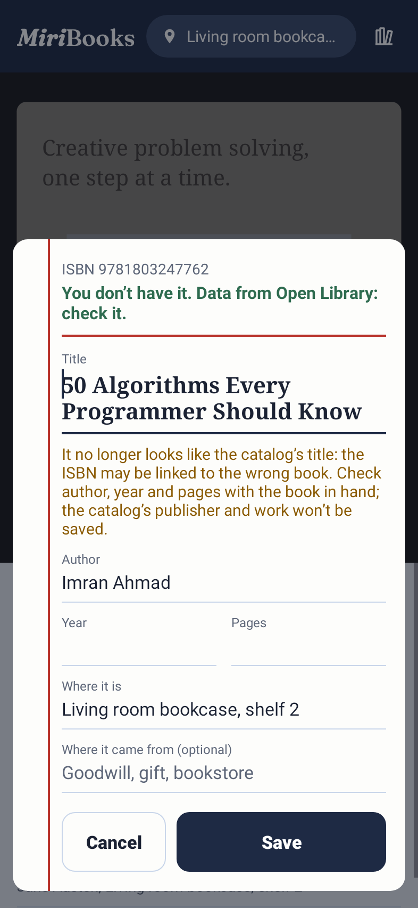

| Message | What it means | What to do |
|---|---|---|
| **You don’t have it. Data from Open Library: check it.** | It's new; the data comes from a catalog. | Check it and save. |
| **You already have it:** PDF, paper (Living room) | It's already in your inventory, with its formats and places. | If it's another paper copy, you can still save it; otherwise close. **View or edit in the Library** opens its full card. |
| **You have another edition** | You own the same book with another ISBN (for example, the PDF). | Decide whether you want this edition too. |
| **I couldn’t find it online** | No catalog knows it. | Type the title and author. |
| **It no longer looks like the catalog’s title** | You corrected the title and it no longer resembles the ISBN's. | That ISBN is often linked to the wrong book; the app keeps your data and ignores the catalog's. |
| **That isn’t the book’s barcode** | You scanned the price or store barcode. | Look for the one that starts with 978 or 979. |

## 7. Books without a barcode

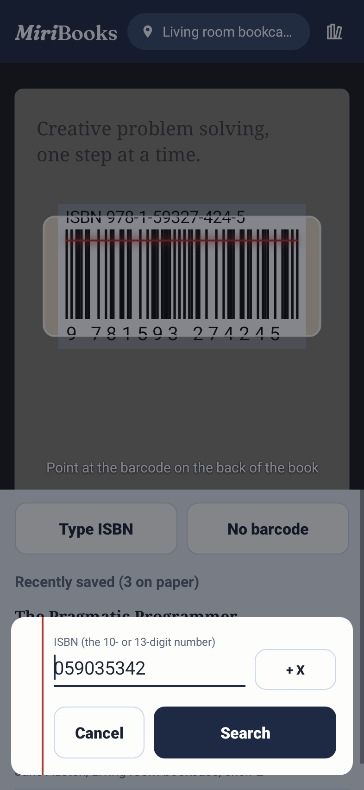

- **Type the ISBN:** if the barcode is covered or damaged, tap **Type ISBN** and type it (with or without
  hyphens; 10 or 13 digits). Many books print it on the copyright page.
- **No barcode:** for old or handmade books, tap **No barcode** and fill in title and author by hand.

 

## 8. Library: search, edit and delete

  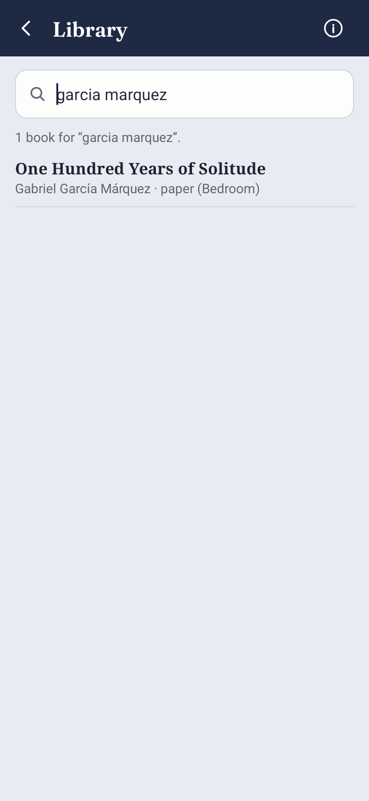
  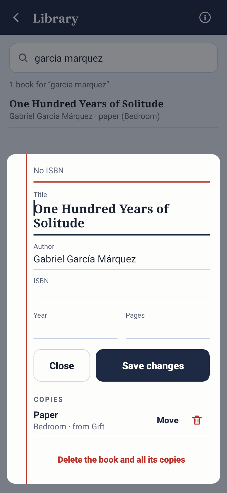

Tap **Library** (top right). It holds **all** your inventory: paper books, PDFs and EPUBs.

- **Search:** type part of the title, the author or the ISBN. Accents don't matter: “cortazar” finds
  Cortázar. With no text, you see the most recently added.
- **Edit:** tap a book, change title, author, ISBN, year or pages and save. What you correct by hand is
  **never** overwritten by the e-book import.
- **Move:** in the list of copies, tap a paper copy to move it to another place or change where it came from.
- **Delete a copy:** from the same sheet. If it was the only one, the book leaves the inventory.
- **Delete the book:** with all its copies. The app always asks you to confirm.

**About digital books:** deleting a PDF or EPUB removes it from the **inventory**, not from your folder. If
the file is still there, it comes back the next time digital books are imported. To remove it for good,
delete the file too.

## 9. About, language and dark mode

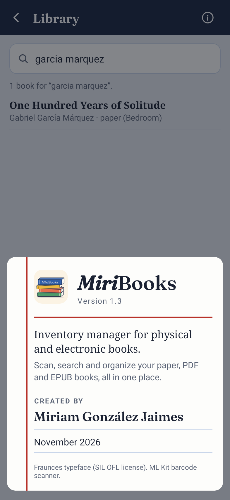

- **About:** in the Library, tap the ⓘ icon to see the app version.
- **Language:** the app speaks English or Spanish depending on your phone's language (Settings → System →
  Languages). Any other language falls back to English.
- **Dark mode:** follows the phone's setting automatically.

 

## 10. Tips for registering lots of books

- **One bookcase at a time.** Choose the place, take out a row, scan it all and put it back. It's faster
  than switching places.
- **Second-hand stickers** often cover the barcode; peel them off before scanning, or type the ISBN.
- **Only check what looks odd.** If the card says “You don't have it” and the title looks right, just save.
- **Before buying:** in a bookstore, scan the book and the card tells you whether you already own it, on
  paper or digital.
- **No signal:** the app needs internet to look up and save. Where there's no signal, stack the books and
  scan them once you're connected.

## 11. FAQ

**Where are my books stored?** In your cloud inventory (BigQuery). The phone doesn't keep the list: if you
lose or replace it, install the app on the new one, register it with the QR code and everything is still
there.

**The first search took a few seconds.** The server sleeps when nobody uses it, to save money; it wakes up
in a few seconds. The next ones are instant.

**Can I register the same book twice?** Yes, if you have two paper copies (one in each house, for example).
Each copy has its own place.

**Why do the PDF and the paper book show up as different books?** Because they almost always have
different ISBNs: they are different editions. The card tells you with “You have another edition”.
